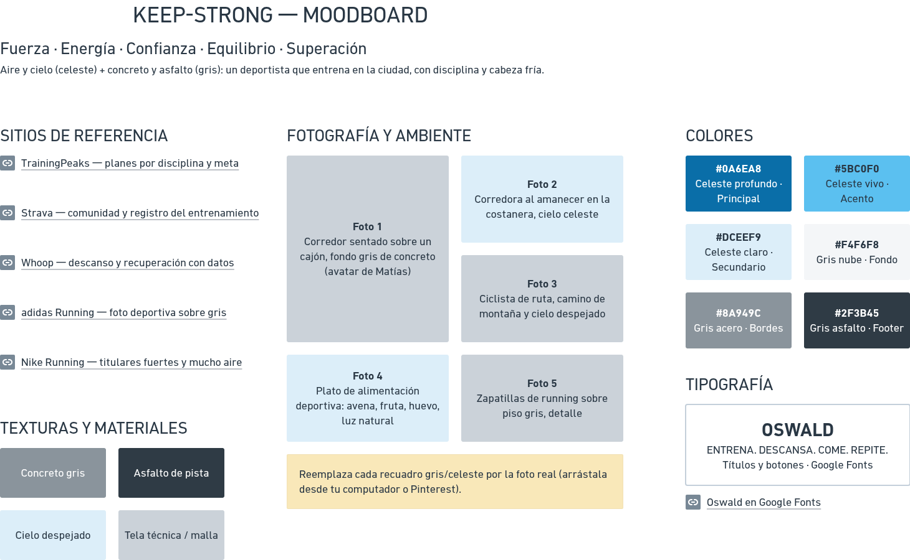

# Moodboard — Keep-Strong

> Guía: [Moodboard](../evaluacion/guias/fase-2-specs/02-moodboard.md)

**Tablero en Whimsical:** https://whimsical.com/7grt3HZhLE3ikKnv6krntA

## Palabras clave

Fuerza · energía · confianza · equilibrio · superación

## Qué sensación buscamos

Queremos que Keep-Strong se sienta como una mañana de entrenamiento en la ciudad: cielo despejado (celeste) sobre concreto y asfalto (gris), con tipografía Oswald, fuerte y directa. Matías prepara su primera maratón con poco tiempo y mucha información contradictoria; un estilo limpio, con fotos reales de deportistas y mucho aire, le transmite orden y disciplina. El celeste aporta energía y frescura (descanso y recuperación), y el gris da seriedad y confianza para dejar su plan en manos de especialistas.
