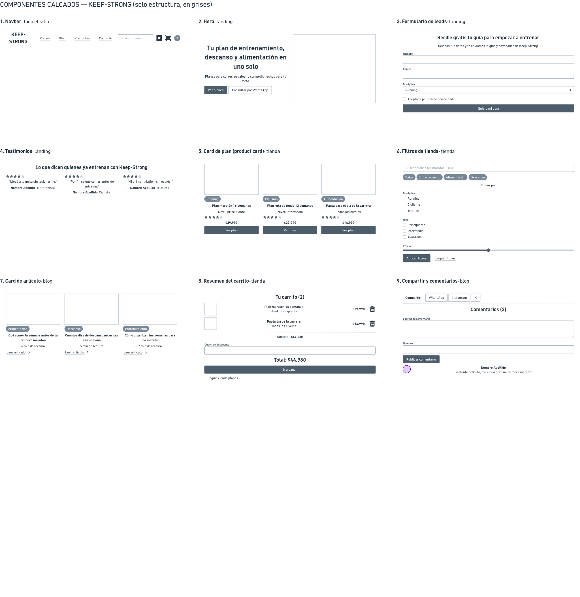

# Componentes — Keep-Strong

> Guía: [Componentes](../evaluacion/guias/fase-2-specs/03-calco-de-componentes.md)

**Tablero en Whimsical:** https://whimsical.com/pablo-ks/keep-strong-componentes-y-wireframes-W9xRfKaYXgcbJPzjnXU2Vz

Los 9 componentes están calcados solo con estructura, en grises. Cubren landing, blog y tienda, y todos responden a las necesidades de Matías, el corredor amateur que prepara su primera maratón.

| Componente | Referencia | Qué contiene | Qué necesidad resuelve |
|---|---|---|---|
| 1. Navbar (todo el sitio) | Nike Running | Logo, enlaces (Planes, Blog, Preguntas, Contacto), buscador, favoritos y carrito con contador | Matías encuentra el buscador y el carrito desde cualquier página, incluso desde el celular |
| 2. Hero (landing) | Strava | Título con la propuesta de valor, bajada, botón "Ver planes", botón "Consultar por WhatsApp" y foto | Entiende en segundos que Keep-Strong integra entrenamiento, descanso y alimentación, y llega a los planes o resuelve una duda |
| 3. Formulario de leads (landing) | Whoop | Título con la oferta (guía gratis), campos de nombre, correo y disciplina, casilla de privacidad y botón | Prueba la marca con una guía gratuita sin arriesgar dinero |
| 4. Testimonios (landing) | TrainingPeaks | Estrellas, frase del cliente, nombre y disciplina | Confía en el plan viendo que otros corredores, ciclistas y triatletas ya llegaron a su meta |
| 5. Card de plan / product card (tienda) | TrainingPeaks (planes de entrenamiento) | Imagen, etiqueta de disciplina, nombre del plan, nivel, estrellas, precio y botón "Ver plan" | Ve disciplina, nivel y precio sin entrar a la ficha, y compara planes rápido |
| 6. Filtros de tienda (tienda) | Decathlon | Buscador, chips de tipo de producto, filtros por disciplina, nivel y precio, y botones para aplicar y limpiar | Encuentra el plan que calza con su nivel y su meta ("maratón", "10K") sin recorrer todo el catálogo |
| 7. Card de artículo (blog) | Runner's World | Imagen, categoría, título, tiempo de lectura y enlace "Leer artículo" | Elige qué leer según su duda (alimentación, descanso, entrenamiento) |
| 8. Resumen del carrito (tienda) | Nike | Productos con imagen, nivel y precio, subtotal, cupón, total, botón "Ir a pagar" y enlace para seguir viendo planes | Ve el precio final antes de pagar y no se lleva sorpresas |
| 9. Compartir y comentarios (blog) | Runner's World | Botones para compartir en WhatsApp, Instagram y X, formulario de comentario y lista de comentarios | Comparte contenido útil con otros corredores y se siente parte de una comunidad |
