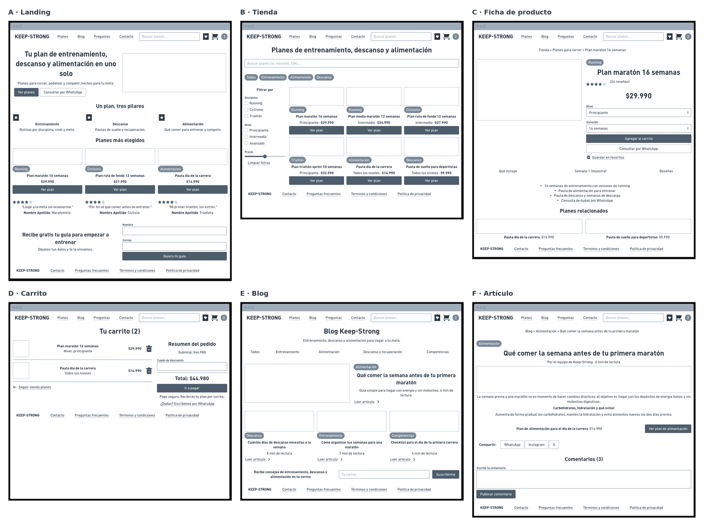

# Spec de diseño — Keep-Strong

> Guía: [Spec de diseño](../evaluacion/guias/fase-2-specs/06-spec-de-diseno.md)

La spec de diseño tiene dos partes:

1. **[`DESIGN.md`](../DESIGN.md)** (en la raíz): tu design system, en el formato que Stitch importa.
2. **Este documento:** tus pantallas, escritas como prompts listos para pegar en Stitch.

**Wireframes en Whimsical:** https://whimsical.com/pablo-ks/keep-strong-componentes-y-wireframes-W9xRfKaYXgcbJPzjnXU2Vz (tablero compartido con los componentes calcados; los wireframes están bajo el título "WIREFRAMES — 6 PANTALLAS")

> Guía de wireframes: [Wireframes](../evaluacion/guias/fase-2-specs/04-wireframes.md)



Los flujos se recorren así: **compra** (A Landing → B Tienda → C Ficha de producto → D Carrito) y **contenido** (E Blog → F Artículo → C Ficha de producto → D Carrito).

## Pantallas

Cada prompt usa los nombres de los componentes de `DESIGN.md` (`navbar`, `button-primary`, `card-plan`, `tag-category`, etc.). Los colores y las tipografías no se repiten: vienen del design system importado. Los nombres de personas en los testimonios son de ejemplo y se reemplazarán por reales en una versión publicada.

### 1. Landing

```text
Pantalla: Landing de Keep-Strong, versión desktop. Usa el design system del proyecto.
Objetivo: que Matías, corredor amateur que prepara su primera maratón, entienda
en segundos que Keep-Strong integra entrenamiento, descanso y alimentación, y
llegue a los planes o deje sus datos para recibir una guía gratis.
Usa los textos tal como están escritos, sin reescribirlos ni agregar cifras, porcentajes
o estadísticas que no se pidan. No nombres a otras marcas.
Componentes, de arriba hacia abajo:
1. navbar con el logo "KEEP-STRONG", enlaces Planes, Blog, Preguntas y Contacto,
   buscador "Buscar planes…", favoritos y carrito con contador "2".
2. Hero de dos columnas. A la izquierda: h1 "Tu plan de entrenamiento, descanso
   y alimentación en uno solo", bajada "Planes para correr, pedalear y competir,
   hechos para tu meta.", button-primary "Ver planes" y button-secondary
   "Consultar por WhatsApp". A la derecha: fotografía de una persona corriendo
   al amanecer en la ciudad, con cielo celeste y pavimento gris.
3. h2 "Un plan, tres pilares" y tres bloques con ícono: "Entrenamiento: rutinas
   por disciplina, nivel y meta.", "Descanso: pautas de sueño y recuperación.",
   "Alimentación: qué comer para entrenar y competir."
4. h2 "Planes más elegidos" y una fila de 3 card-plan, cada una con tag-category
   y button-primary "Ver plan": Plan maratón 16 semanas (Running, $29.990),
   Plan ruta de fondo 12 semanas (Ciclismo, $27.990), Pauta día de la carrera
   (Alimentación, $14.990).
5. h2 "Lo que dicen quienes ya entrenan con Keep-Strong" y 3 card-testimonial
   con estrellas: "Llegué a la meta sin lesionarme." (Javiera M., Maratonista),
   "Por fin sé qué comer antes de entrenar." (Diego P., Ciclista), "Mi primer
   triatlón, sin estrés." (Andrea S., Triatleta).
6. form-lead con el título "Recibe gratis tu guía para empezar a entrenar",
   la bajada "Déjanos tus datos y te la enviamos.", campos input-field Nombre,
   Correo y Disciplina (Running), casilla "Acepto la política de privacidad" y
   button-primary "Quiero mi guía".
7. footer con el logo y los enlaces Contacto, Preguntas frecuentes, Términos y
   condiciones y Política de privacidad.
```

### 2. Tienda

```text
Pantalla: Tienda de Keep-Strong, versión desktop. Usa el design system del proyecto.
Objetivo: que Matías encuentre rápido el plan que calza con su disciplina, su
nivel y su meta, viendo el precio de cada uno.
Componentes, de arriba hacia abajo:
1. navbar (igual que en la landing).
2. h1 "Planes de entrenamiento, descanso y alimentación" y un input-field de
   buscador con el texto "Buscar planes (ej. maratón, 10K)…".
3. Chips chip-filter: Todos (chip-filter-active), Entrenamiento, Alimentación,
   Descanso.
4. A la izquierda, columna de filtros de 240px con el título "Filtrar por":
   "Disciplina" (Running, Ciclismo, Triatlón), "Nivel" (Principiante,
   Intermedio, Avanzado), un control de rango de "Precio" y el enlace "Limpiar
   filtros". A la derecha, grilla de 3 columnas con 6 card-plan, cada una con
   tag-category, nivel, precio y button-primary "Ver plan":
   Plan maratón 16 semanas (Running, Principiante, $29.990),
   Plan media maratón 12 semanas (Running, Intermedio, $24.990),
   Plan ruta de fondo 12 semanas (Ciclismo, Intermedio, $27.990),
   Plan triatlón sprint 10 semanas (Triatlón, Principiante, $32.990),
   Pauta día de la carrera (Alimentación, Todos los niveles, $14.990),
   Pauta de sueño para deportistas (Descanso, Todos los niveles, $9.990).
5. footer.
```

### 3. Ficha de producto

```text
Pantalla: Ficha de producto de Keep-Strong (Plan maratón 16 semanas), versión desktop.
Usa el design system del proyecto.
Objetivo: que Matías entienda qué incluye el plan, vea reseñas y precio, elija
su variante y lo agregue al carrito sin dudas.
Componentes, de arriba hacia abajo:
1. navbar.
2. Ruta de navegación: "Tienda > Planes para correr > Plan maratón 16 semanas".
3. Dos columnas. A la izquierda: imagen grande del plan (corredor en una ruta
   urbana). A la derecha: tag-category "Running", h1 "Plan maratón 16 semanas",
   estrellas con "(24 reseñas)", precio "$29.990" en title-md, input-field
   desplegable "Nivel" (Principiante) y "Duración" (16 semanas), button-primary
   "Agregar al carrito" con el texto en una sola línea, button-secondary
   "Consultar por WhatsApp" y el enlace "Guardar en favoritos". No agregues
   bloques de garantía ni menciones a otras marcas.
4. Pestañas: "Qué incluye" (activa), "Semana 1 (muestra)" y "Reseñas". Bajo "Qué
   incluye", la lista: "16 semanas de entrenamiento con sesiones de running",
   "Pauta de alimentación para entrenar", "Pauta de descanso y semanas de
   descarga", "Consulta de dudas por WhatsApp".
5. h2 "Planes relacionados" y 2 card-plan: Pauta día de la carrera ($14.990) y
   Pauta de sueño para deportistas ($9.990).
6. footer.
```

### 4. Carrito

```text
Pantalla: Carrito de Keep-Strong, versión desktop. Usa el design system del proyecto.
Objetivo: que Matías revise lo que va a comprar, vea el total final sin
sorpresas y avance a pagar.
Componentes, de arriba hacia abajo:
1. navbar.
2. h1 "Tu carrito (2)".
3. Dos columnas. A la izquierda, lista de productos separados por divider, cada
   uno con imagen, nombre, nivel, precio y un ícono para eliminar: "Plan
   maratón 16 semanas, nivel principiante, $29.990" y "Pauta día de la carrera,
   todos los niveles, $14.990", y al final el enlace "Seguir viendo planes".
   A la derecha, cart-summary con el título "Resumen del pedido", "Subtotal:
   $44.980", un input-field "Cupón de descuento", "Total: $44.980",
   button-primary "Ir a pagar", el texto "Pago seguro. Recibirás tu plan por
   correo." y el enlace "¿Dudas? Escríbenos por WhatsApp" (obligatorio, bajo el botón).
   No agregues métodos de pago, pasos del proceso ni menciones a otras marcas.
4. footer.
```

### 5. Blog

```text
Pantalla: Blog de Keep-Strong, versión desktop. Usa el design system del proyecto.
Objetivo: que Matías resuelva sus dudas de entrenamiento, descanso y alimentación
con contenido confiable y llegue a un plan relacionado.
Componentes, de arriba hacia abajo:
1. navbar.
2. h1 "Blog Keep-Strong" y la bajada "Entrenamiento, descanso y alimentación para
   llegar a tu meta."
3. Chips chip-filter de categoría: Todos (chip-filter-active), Entrenamiento,
   Alimentación, Descanso y recuperación, Competencias.
4. Artículo destacado en dos columnas: imagen a la izquierda; a la derecha
   tag-category "Alimentación", h2 "Qué comer la semana antes de tu primera
   maratón", "Guía simple para llegar con energía y sin molestias. 6 min de
   lectura." y el enlace "Leer artículo", sin nombres de personas.
5. Fila de 3 card-article: "Cuántos días de descanso necesitas a la semana"
   (Descanso, 5 min de lectura), "Cómo organizar tus semanas para una maratón"
   (Entrenamiento, 7 min de lectura), "Checklist para el día de tu primera
   carrera" (Competencias, 4 min de lectura).
6. Bloque de suscripción: "Recibe consejos de entrenamiento, descanso y
   alimentación en tu correo", input-field "Tu correo" y button-primary
   "Suscribirme".
7. footer.
```

### 6. Artículo

```text
Pantalla: Artículo del blog de Keep-Strong, versión desktop. Usa el design system del proyecto.
Objetivo: que Matías lea la guía, comparta el artículo o comente, y llegue al plan
de alimentación recomendado.
Usa el texto del cuerpo tal como está escrito, sin reescribirlo. La imagen de
portada no debe tener marcas comerciales ni nombres o números de competidores.
Componentes, de arriba hacia abajo:
1. navbar.
2. Ruta de navegación: "Blog > Alimentación > Qué comer la semana antes de tu
   primera maratón".
3. tag-category "Alimentación", h1 "Qué comer la semana antes de tu primera
   maratón" y "Por el equipo de Keep-Strong · 6 min de lectura".
4. Imagen de portada ancha y el cuerpo del artículo: "La semana previa a una
   maratón no es momento de hacer cambios drásticos: el objetivo es llegar con
   los depósitos de energía llenos y sin molestias digestivas.", h2
   "Carbohidratos, hidratación y qué evitar" y "Aumenta de forma gradual los
   carbohidratos, mantén la hidratación y evita alimentos nuevos los dos días
   previos."
5. Bloque de recomendación: "Plan de alimentación para el día de la carrera ·
   $14.990" con button-primary "Ver plan de alimentación".
6. "Compartir:" con tres button-secondary: WhatsApp, Instagram y X.
7. h2 "Comentarios (3)", un input-field de texto largo "Escribe tu comentario" y
   button-primary "Publicar comentario".
8. footer.
```

### Versión mobile (para cada pantalla)

```text
Genera la versión mobile (375px de ancho) de esta pantalla siguiendo la
sección Layout del design system: una sola columna con márgenes de 16px, navbar
con menú hamburguesa y el buscador y el carrito siempre visibles, las grillas
de card-plan y card-article en 1 por fila, imágenes arriba del texto, botones
de ancho completo con área táctil de al menos 44px y sin scroll horizontal.
Mantén los mismos textos y componentes de la versión desktop.
```

Ajustes específicos de cada pantalla en mobile (se agregan al prompt anterior):

- **Landing:** hero con la imagen arriba y los dos botones apilados; los tres pilares y los testimonios en una columna; `form-lead` con los campos apilados.
- **Tienda:** los filtros no van en columna: agrega un botón "Filtros" que abre un panel a pantalla completa; los chips se desplazan en horizontal.
- **Ficha de producto:** imagen, datos y botones apilados; "Agregar al carrito" fijo en la parte inferior de la pantalla.
- **Carrito:** lista de productos y debajo `cart-summary`; "Ir a pagar" de ancho completo.
- **Blog:** artículo destacado con la imagen arriba; `card-article` en 1 por fila; chips con desplazamiento horizontal.
- **Artículo:** columna única; los tres botones de compartir en una fila; formulario de comentario de ancho completo.
