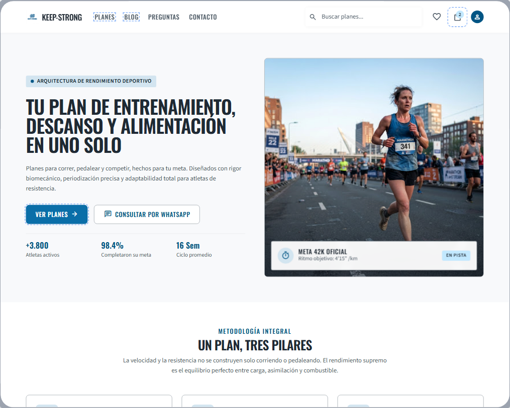
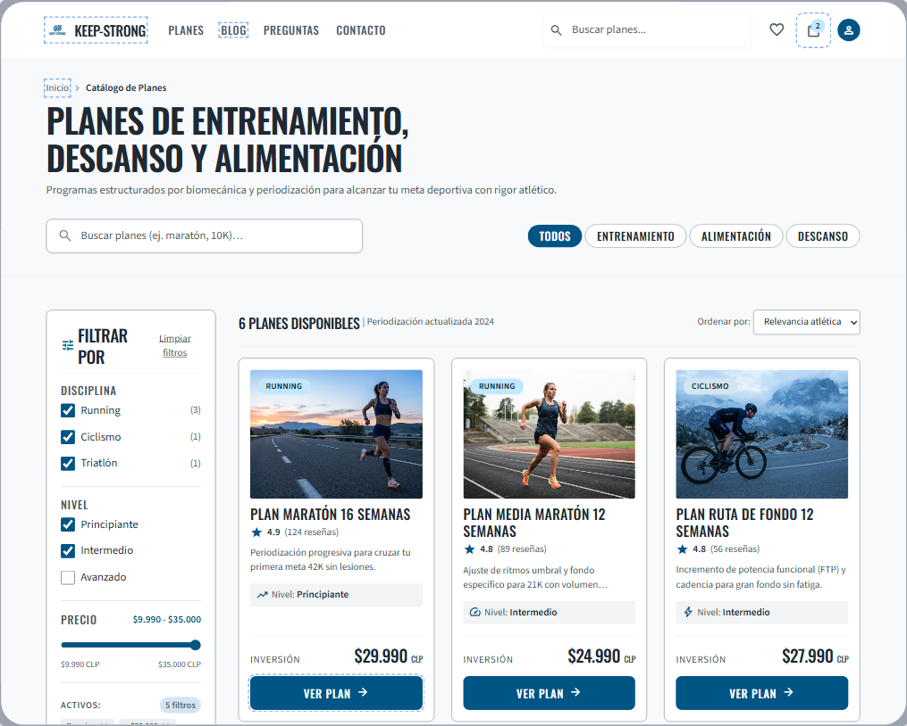
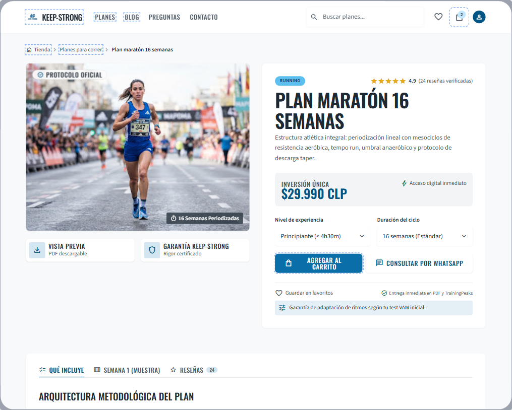
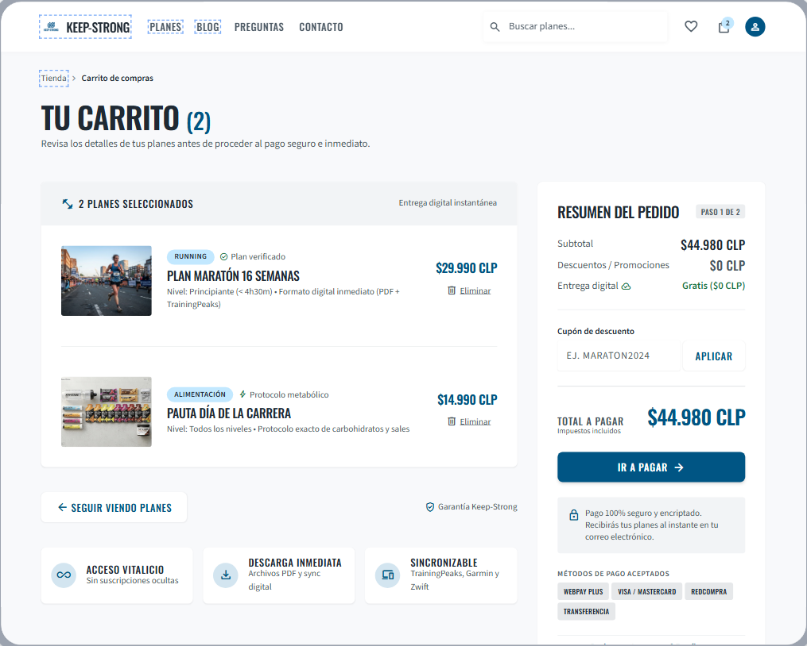
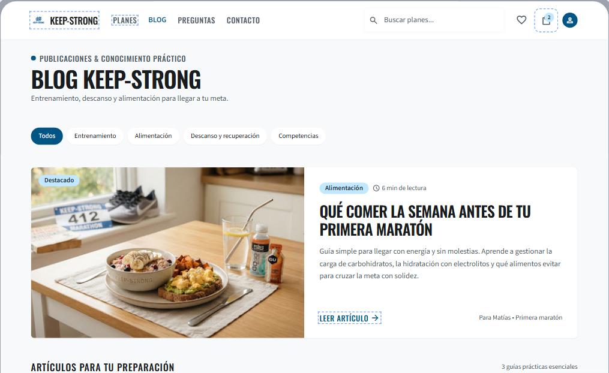
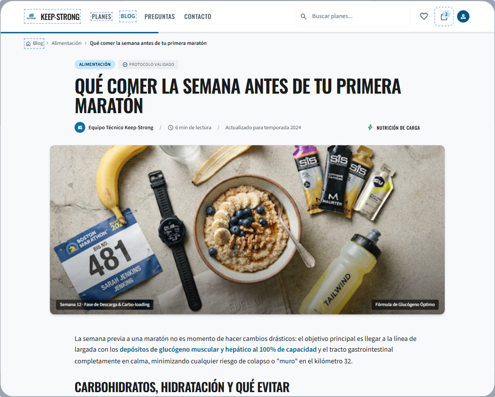

# QA — Keep-Strong

> Guía: [QA y coherencia](../evaluacion/guias/fase-3-prototipo/02-qa-y-coherencia.md)

> **Estado:** las 6 pantallas desktop están generadas y revisadas contra la spec (solo lo visible en cada captura; la parte baja de varias pantallas queda fuera del encuadre). **Pendiente:** versiones mobile, correcciones en Stitch, recorrido de los flujos y reflexión de coherencia.

## Prototipo en Stitch

> Guía: [Prototipo en Stitch](../evaluacion/guias/fase-3-prototipo/01-prototipo-en-stitch.md)

**Proyecto:** https://stitch.google.com/projects/726846259671181243 *(verificar que esté compartido con "cualquiera con el enlace")*

<!-- Capturas en docs/img/, sin espacios ni tildes: prototipo-tienda-desktop.png, prototipo-tienda-mobile.png, etc. -->

| Pantalla | Desktop | Mobile |
|---|---|---|
| Landing |  | *pendiente* |
| Tienda |  | *pendiente* |
| Ficha de producto |  | *pendiente* |
| Carrito |  | *pendiente* |
| Blog |  | *pendiente* |
| Artículo |  | *pendiente* |

## Revisión: spec vs. prototipo

<!-- Resultado: ✅ se cumplió / ❌ no se cumple (pendiente de corregir). Pasa a ❌ → ✅ cuando lo corrijas en Stitch o en la spec. -->

| Pantalla | Qué dice la spec | Qué generó Stitch | Resultado | Corrección |
|---|---|---|---|---|
| Landing | h1 "Tu plan de entrenamiento, descanso y alimentación en uno solo", `button-primary` "Ver planes" y `button-secondary` "Consultar por WhatsApp" | Título y los dos botones tal cual | ✅ | — |
| Landing | Bajada "Planes para correr, pedalear y competir, hechos para tu meta." | Agregó "Diseñados con rigor biomecánico, periodización precisa y adaptabilidad total para atletas de resistencia" | ❌ | Fijar el texto exacto en el prompt |
| Landing | No pide cifras en el hero | Inventó "+3.800 atletas activos", "98.4% completaron su meta" y "16 Sem ciclo promedio", más una tarjeta "Meta 42K oficial" | ❌ | Agregar al prompt y a Do's and Don'ts: no inventar cifras ni datos |
| Landing | Foto de persona corriendo al amanecer en la ciudad | Corredora en una maratón con otros corredores y pancartas | ❌ | Reemplazar por foto del moodboard en la versión de código |
| Landing | "Un plan, tres pilares" | Aparece "Un plan, tres pilares" (el contenido de las tarjetas queda fuera de la captura) | ✅ | Revisar la parte inferior |
| Tienda | Chips (Todos activo), buscador, filtros de 240px (Disciplina, Nivel, Precio, "Limpiar filtros") | Todo presente y en el orden pedido | ✅ | — |
| Tienda | Precio visible y un solo `button-primary` por `card-plan` | Cada card muestra "Inversión" con precio y un botón "Ver plan" | ✅ | — |
| Tienda | Filtros sin elementos extra | Agregó "Ordenar por", "6 planes disponibles", "5 filtros activos", migas de pan y un descriptor en cada card | ❌ | Decidir si se aceptan; si no, indicarlo en el prompt |
| Tienda | Precios y nombres de los planes | Coinciden ($29.990, $24.990, $27.990); las otras 3 cards quedan fuera de la captura | ✅ | Revisar las 3 restantes |
| Ficha de producto | Ruta de navegación, tag "Running", h1, estrellas con "(24 reseñas)", precio, "Nivel" y "Duración" | Todo presente. El precio dice "Inversión única" y las reseñas "verificadas" | ✅ | — |
| Ficha de producto | "Agregar al carrito" (`button-primary`) y "Consultar por WhatsApp" (`button-secondary`) | Presentes; "Agregar al carrito" se parte en dos líneas | ❌ | Pedir botón más ancho o texto en una línea |
| Ficha de producto | Pestañas "Qué incluye", "Semana 1 (muestra)" y "Reseñas" | Presentes; "Reseñas" con contador 24 | ✅ | — |
| Ficha de producto | No pide más bloques | Agregó "Protocolo oficial", "Vista previa PDF", "Garantía Keep-Strong" y "Entrega en PDF y TrainingPeaks" (menciona a un competidor) | ❌ | Quitar la mención a TrainingPeaks en el prompt |
| Carrito | h1 "Tu carrito (2)", lista con `divider`, "Seguir viendo planes" | Todo presente | ✅ | — |
| Carrito | `cart-summary`: subtotal $44.980, cupón, total $44.980, "Ir a pagar", texto de pago seguro | Todo presente con los montos correctos | ✅ | — |
| Carrito | Texto "¿Dudas? Escríbenos por WhatsApp" | No se ve en la captura (puede estar bajo el borde) | ❌ | Revisar al hacer scroll; si falta, pedirlo |
| Carrito | Resumen simple | Agregó "Descuentos / Promociones", "Entrega digital gratis", "Paso 1 de 2", métodos de pago y tres bloques de beneficios; el detalle del plan nombra a TrainingPeaks | ❌ | Quitar la mención a TrainingPeaks; decidir si se acepta el resto |
| Blog | h1, bajada y chips (Todos activo) | Todo presente con los textos exactos | ✅ | — |
| Blog | Artículo destacado: tag Alimentación, h2, bajada, "6 min de lectura", "Leer artículo" | Presente con el texto de la spec ampliado | ✅ | — |
| Blog | No pide etiquetas con nombres | Agregó "Para Matías · Primera maratón" en el destacado; Matías es la proto-persona, no un dato para el público | ❌ | Quitarlo del prompt y de la pantalla |
| Blog | 3 `card-article` y bloque de suscripción | Se ven las cards (Descanso, Entrenamiento, Competencias); la suscripción queda fuera de la captura | ✅ | Revisar el bloque de suscripción |
| Artículo | Ruta de navegación, tag, h1 y "Por el equipo de Keep-Strong · 6 min de lectura" | Presentes ("Equipo Técnico Keep-Strong") | ✅ | — |
| Artículo | Cuerpo con el texto exacto del prompt | Redactó otro texto ("depósitos de glucógeno muscular y hepático al 100%…") | ❌ | Pegar el texto exacto en el prompt |
| Artículo | Imagen de portada | Fotografía con una cédula de la maratón de Boston con un nombre y marcas comerciales (SiS, Garmin) | ❌ | Reemplazar por una imagen sin marcas ni nombres |
| Artículo | Bloque de recomendación, compartir y comentarios | Quedan fuera de la captura | ❌ | Revisar con scroll |
| Todas (DESIGN.md) | `primary` #0A6EA8 en acciones, fondos claros, sin degradados | Botones y chips activos en azul `primary`, fondos claros, tags en celeste | ✅ | — |
| Todas (DESIGN.md) | Oswald en títulos, precios y botones; Source Sans 3 en párrafos | Títulos condensados tipo Oswald y párrafos en sans legible | ✅ | — |
| Todas (DESIGN.md) | Navbar: logo, Planes, Blog, Preguntas, Contacto, buscador, favoritos y carrito con contador | Igual en las 6 pantallas; el carrito marca "2" | ✅ | — |
| Mobile | Una columna, hamburguesa, botones de ancho completo, sin scroll horizontal | Aún no generado | ❌ | Generar las 6 versiones mobile |

## Mejoras a mis specs

- En `DESIGN.md` → Don'ts, agregué tres reglas: no inventar cifras ni datos, no nombrar a otras marcas ni usar el nombre de la proto-persona en textos públicos, y no usar fotos con marcas comerciales ni nombres de competidores. Salieron de la Landing (cifras inventadas), la Ficha y el Carrito (TrainingPeaks), el Blog ("Para Matías") y el Artículo (cédula con nombre y marcas). Commit: `fix(DESIGN.md)`.
- En `docs/09-spec-diseno.md`, los prompts ahora piden usar los textos tal cual (Landing y Artículo), el botón "Agregar al carrito" en una línea, el enlace de WhatsApp obligatorio en el Carrito, y prohíben bloques de garantía, métodos de pago, nombres de personas y menciones a otras marcas. Commit: `fix(docs/09)`.
- **Pendiente:** volver a generar las pantallas con los prompts corregidos y pasar a ❌ → ✅ las filas de la tabla que se resuelvan.

## User flows

> Los flujos vienen de [`docs/05-arquitectura.md`](05-arquitectura.md). Cada paso necesita su pantalla y su botón o enlace.

| Flujo | Recorrido esperado | Recorrido en el prototipo | ¿Se completa? |
|---|---|---|---|
| Compra | Landing → [Ver planes] → Tienda → [Ver plan] → Ficha de producto → [Agregar al carrito] → Carrito → [Ir a pagar] | Las 4 pantallas existen y cada una tiene el botón del paso siguiente. Falta comprobar en Preview que los botones enlacen entre pantallas | *pendiente* |
| Contenido | Blog → [Leer artículo] → Artículo → [Ver plan de alimentación] → Ficha de producto → [Agregar al carrito] → Carrito | Blog tiene "Leer artículo". Falta ver el bloque "Ver plan de alimentación" del Artículo (fuera de la captura) y probar los enlaces | *pendiente* |

## Coherencia

*(Borrador escrito con la revisión desktop; se ajusta cuando estén las versiones mobile y los flujos probados.)*

El objetivo del brief es vender online los planes de Keep-Strong y captar deportistas. El prototipo lo cubre con el flujo de compra completo: de la Landing se llega a la Tienda con "Ver planes", de ahí a la Ficha y al Carrito, y cada pantalla muestra el precio y el botón del paso siguiente. El segundo objetivo, posicionar la marca con contenido útil, lo resuelven el Blog y el Artículo, que enlazan al plan de alimentación recomendado.

Para Matías, el corredor que prepara su primera maratón, el prototipo responde a sus frustraciones principales. Los planes genéricos se resuelven con los filtros de disciplina y nivel de la Tienda. La duda sobre qué incluye cada plan, con la pestaña "Qué incluye" y la muestra de la semana 1 en la Ficha. Los sitios que esconden el precio, con el precio visible en cada card y el total sin sorpresas en el Carrito. Y la necesidad de consultar antes de comprar, con "Consultar por WhatsApp" en la Landing y en la Ficha.

Lo que cambió desde la Fase 1: la spec no pedía cifras de resultados, pero Stitch las inventó ("+3.800 atletas", "98.4%"), y lo corregí en el `DESIGN.md` y en los prompts porque no podemos publicar datos que no son reales. Tampoco pedimos nombrar a TrainingPeaks ni a Matías en el sitio: son referentes y persona de trabajo, no contenido para el público. Además, el filtro por "objetivo" salió de las specs para dejar solo disciplina, nivel y precio, que son los que muestran los wireframes.
