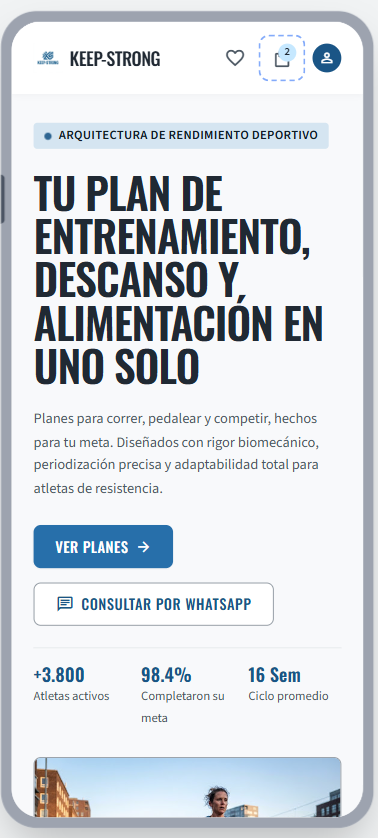
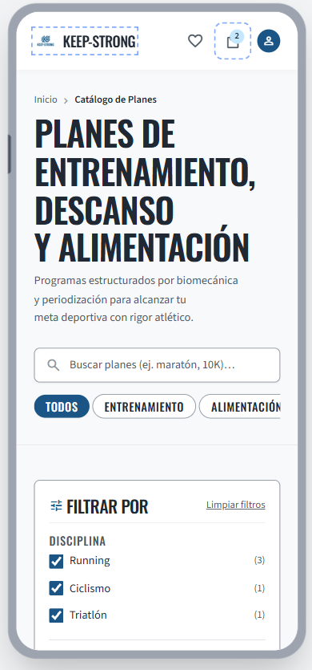
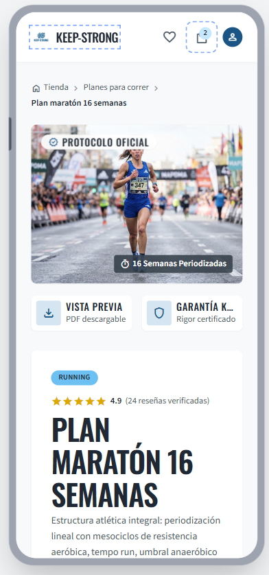
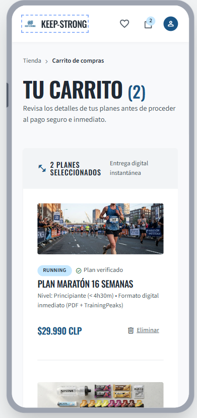
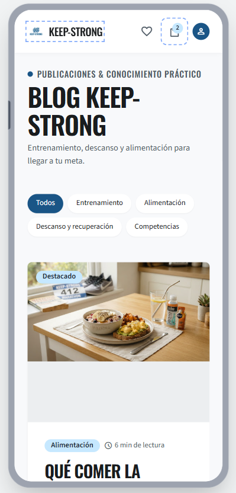
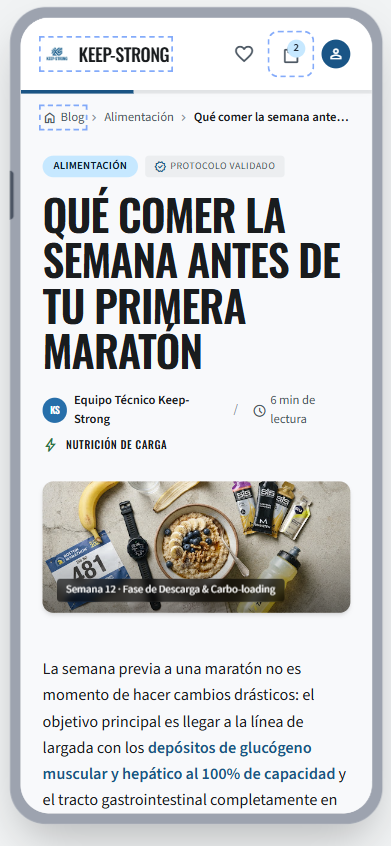

# QA — Keep-Strong

> Guía: [QA y coherencia](../evaluacion/guias/fase-3-prototipo/02-qa-y-coherencia.md)

> **Estado:** plantilla preparada con lo que dice la spec. Las columnas "Qué generó Stitch", "Resultado" y "Corrección", las capturas y la reflexión de coherencia se completan **después de generar y revisar el prototipo**. No se rellenan antes para no anotar resultados que no existen.

## Prototipo en Stitch

> Guía: [Prototipo en Stitch](../evaluacion/guias/fase-3-prototipo/01-prototipo-en-stitch.md)

**Proyecto:** [pega aquí el link de Stitch, abierto para cualquiera con el enlace]

<!-- Capturas en docs/img/, sin espacios ni tildes: prototipo-tienda-desktop.png, prototipo-tienda-mobile.png, etc. -->

| Pantalla | Desktop | Mobile |
|---|---|---|
| Landing |  |  |
| Tienda |  |  |
| Ficha de producto |  |  |
| Carrito |  |  |
| Blog |  |  |
| Artículo |  |  |

## Revisión: spec vs. prototipo

<!-- Una fila por diferencia. Resultado: ✅ / ❌ → ✅ / ❌. Agrega filas según lo que encuentres. -->

| Pantalla | Qué dice la spec | Qué generó Stitch | Resultado | Corrección |
|---|---|---|---|---|
| Landing | Hero con h1 "Tu plan de entrenamiento, descanso y alimentación en uno solo", `button-primary` "Ver planes" y `button-secondary` "Consultar por WhatsApp" | | | |
| Landing | Tres pilares (Entrenamiento, Descanso, Alimentación) y 3 `card-plan` con precio y `tag-category` | | | |
| Landing | 3 `card-testimonial` y `form-lead` con Nombre, Correo, Disciplina y casilla de privacidad | | | |
| Tienda | Chips (Todos activo), columna de filtros de 240px (Disciplina, Nivel, Precio) y 6 `card-plan` en 3 columnas | | | |
| Tienda | Precio visible en todas las `card-plan`; un solo `button-primary` por card | | | |
| Ficha de producto | Ruta de navegación, "Nivel" y "Duración", "Agregar al carrito" (`button-primary`) y "Consultar por WhatsApp" (`button-secondary`) | | | |
| Ficha de producto | Pestañas "Qué incluye", "Semana 1 (muestra)" y "Reseñas", y 2 `card-plan` relacionados | | | |
| Carrito | Lista con `divider`, `cart-summary` con subtotal, cupón, total y "Ir a pagar" | | | |
| Blog | Chips de categoría, artículo destacado, 3 `card-article` con tiempo de lectura y bloque de suscripción | | | |
| Artículo | Ruta de navegación, bloque "Plan de alimentación para el día de la carrera · $14.990", 3 botones de compartir y comentarios | | | |
| Todas (DESIGN.md) | Colores solo de los tokens: `primary` #0A6EA8 en acciones, `tertiary` solo como fondo con texto oscuro; sin degradados ni sombras fuertes | | | |
| Todas (DESIGN.md) | Oswald en títulos, precios y botones; Source Sans 3 en párrafos | | | |
| Mobile | Una columna, márgenes de 16px, menú hamburguesa, buscador y carrito visibles, botones de ancho completo de al menos 44px, sin scroll horizontal | | | |
| Tienda (mobile) | Botón "Filtros" que abre un panel; chips con scroll horizontal | | | |
| Ficha (mobile) | "Agregar al carrito" fijo en la parte inferior | | | |

## Mejoras a mis specs

<!-- Qué cambiaste en DESIGN.md o en tus prompts después de ver el resultado. Un commit por cada mejora. -->

-

## User flows

> Los flujos vienen de [`docs/05-arquitectura.md`](05-arquitectura.md). Cada paso necesita su pantalla y su botón o enlace.

| Flujo | Recorrido esperado | Recorrido en el prototipo | ¿Se completa? |
|---|---|---|---|
| Compra | Landing → [Ver planes] → Tienda → [Ver plan] → Ficha de producto → [Agregar al carrito] → Carrito → [Ir a pagar] | | |
| Contenido | Blog → [Leer artículo] → Artículo → [Ver plan de alimentación] → Ficha de producto → [Agregar al carrito] → Carrito | | |

## Coherencia

<!-- 5 a 10 líneas, escritas después de revisar el prototipo. Responde:
- ¿Cómo responde el prototipo al objetivo del brief (docs/01-brief.md)?
- ¿Qué necesidades y frustraciones de Matías resuelve, y con qué pantallas o componentes?
- ¿Qué cambió desde la Fase 1 y por qué? -->
